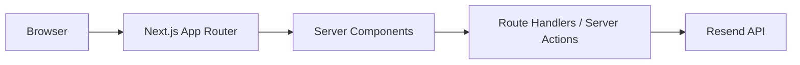

<div align="center">

# Alamin Ahmed

### Full Stack Developer · AI Automation Engineer

Building scalable, high-performance web applications with Next.js, TypeScript, Prisma and AI.

<br />

[](https://my-portfolio-alpha-orcin-4xkhsnjiby.vercel.app)
[](https://github.com/Alaminahmedariyan)
[](https://www.linkedin.com/in/alamin-ahmed-536463382)


</div>

---

## 📖 About

The source code of my personal developer portfolio. It showcases my featured projects, technical skills and experience, with a focus on clean design, performance and a polished user experience — a single place for recruiters, clients and collaborators to get to know my work.

**👉 Live site:** https://my-portfolio-alpha-orcin-4xkhsnjiby.vercel.app

---

## 🖼️ Screenshots

<!-- Add screenshots to public/images/preview and update the paths below -->

| Home | Projects |
|---|---|
|  |  |

| Project details | Contact |
|---|---|
|  |  |

---

## ✨ Features

- **Modern stack** — Next.js 16 App Router, React 19, TypeScript, Tailwind CSS v4
- **Premium UI** — glassmorphism design with smooth animations (Framer Motion)
- **Dark / light mode** and fully responsive layouts
- **Dynamic project pages** for every featured project
- **Working contact form** delivering email through Resend
- **SEO ready** — Metadata API, Open Graph, Twitter cards, sitemap, robots.txt, canonical URLs
- **PWA manifest** and optimized images
- **Accessibility-friendly** markup

---

## 🧰 Tech Stack

| Layer | Technologies |
|---|---|
| **Frontend** | Next.js 16 · React 19 · TypeScript · Tailwind CSS v4 · Framer Motion · Lucide React |
| **Backend** | Next.js Route Handlers · Server Actions |
| **Email** | Resend |
| **Deployment** | Vercel |

---

## 🚀 Featured Projects

| Project | Description | Tech |
|---|---|---|
| 🚀 **Launch Hunt** | Premium product launch platform inspired by Product Hunt | Next.js · TypeScript · Prisma · PostgreSQL · Tailwind CSS |
| 🤖 **LeadPulse** | AI-powered lead generation & sales automation platform | Next.js · LangChain · OpenAI · n8n · Prisma |
| 📄 **ResuAI** | AI resume builder & ATS resume optimizer | Next.js · TypeScript · OpenAI · Prisma |
| 🌱 **EcoSpark Hub** | Community sustainability platform | React · Express · MongoDB |
| 📚 **RateMyTutor** | Tutor review & booking platform | Next.js · Prisma · PostgreSQL |
| 💳 **InvoiceSync** | Invoice management SaaS | Next.js · Prisma · PostgreSQL |

---

## 🏗️ Architecture



---

## 📂 Project Structure

```
src/
├── app/            # App Router (layout, api, projects)
├── components/     # UI components
├── data/           # Project & skills data
├── hooks/          # Custom hooks
├── lib/            # Helpers & clients
├── providers/      # Context providers (theme, etc.)
├── styles/         # Global styles
├── types/          # TypeScript types
└── utils/          # Utilities

public/
├── images/
├── icons/
└── favicon/
```

---

## 🏁 Getting Started

```bash
# 1. Clone
git clone https://github.com/YOUR_USERNAME/full-stack-portfolio.git
cd full-stack-portfolio

# 2. Install
npm install

# 3. Configure environment (see below)

# 4. Run
npm run dev
```

Open [http://localhost:3000](http://localhost:3000).

| Command | Description |
|---|---|
| `npm run dev` | Start the development server |
| `npm run build` | Create a production build |
| `npm start` | Start the production server |

### Environment variables

Create a `.env` file in the project root:

```env
RESEND_API_KEY=your_resend_api_key
CONTACT_EMAIL=your_email@example.com
```

---

## ☁️ Deployment

Deployed on **Vercel**: import the repository, add the environment variables above, and deploy.

---

## 📬 Contact

| | |
|---|---|
| 🌐 Portfolio | [my-portfolio-alpha-orcin-4xkhsnjiby.vercel.app](https://my-portfolio-alpha-orcin-4xkhsnjiby.vercel.app) |
| 💻 GitHub | [@Alaminahmedariyan](https://github.com/Alaminahmedariyan) |
| 💼 LinkedIn | [Alamin Ahmed](https://www.linkedin.com/in/alamin-ahmed-536463382) |
| ✉️ Email | alaminahmedariyan2022@gmail.com |

---

## 📄 License

Distributed under the **MIT License**.

<div align="center">

<br />

Made with ❤️ by **Alamin Ahmed**

</div>